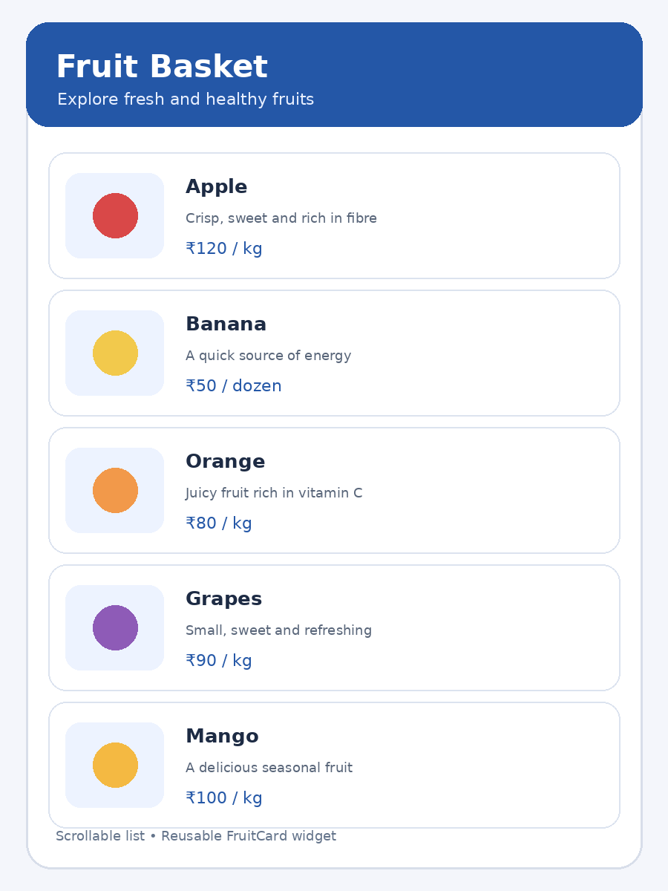

# Experiment 1 – Working with Widgets and Layouts

## Aim

To design and develop a Flutter application that displays a list of fruit items using Row, Column, Container, Card and ListView widgets, and to organize the user interface using reusable custom widgets.

## Description

Flutter provides a collection of widgets for building user interfaces. Row arranges its children horizontally, while Column arranges them vertically. Container is used to add padding, dimensions and decoration. Card presents related information in an elevated panel, and ListView displays a scrollable collection of items. In this experiment, a Fruit model stores each fruit's name, description, price, icon and color. A reusable FruitCard custom widget displays each item, reducing repeated code and keeping the interface organized. ListView.builder creates the fruit cards from the predefined list.

## Widgets Used

- **MaterialApp** – Provides the application structure and theme.
- **Scaffold** – Provides the basic page layout and AppBar.
- **Container** – Adds spacing, padding and background color.
- **Row** – Places the fruit icon and details horizontally.
- **Column** – Arranges the title, description and price vertically.
- **Card** – Displays each fruit in a separate card.
- **ListView.builder** – Builds a scrollable list of fruit items.

## Technologies Used

- Flutter
- Dart
- MaterialApp
- Scaffold
- Container
- Row
- Column
- Card
- ListView.builder

## How to Run

```bash
flutter pub get
flutter run
```

## Output Screenshots



## Result

Thus, the Flutter application to display fruit items using Row, Column, Container, Card and ListView widgets was designed and developed successfully. A reusable FruitCard custom widget was implemented to display each fruit in a structured and scrollable user interface.
