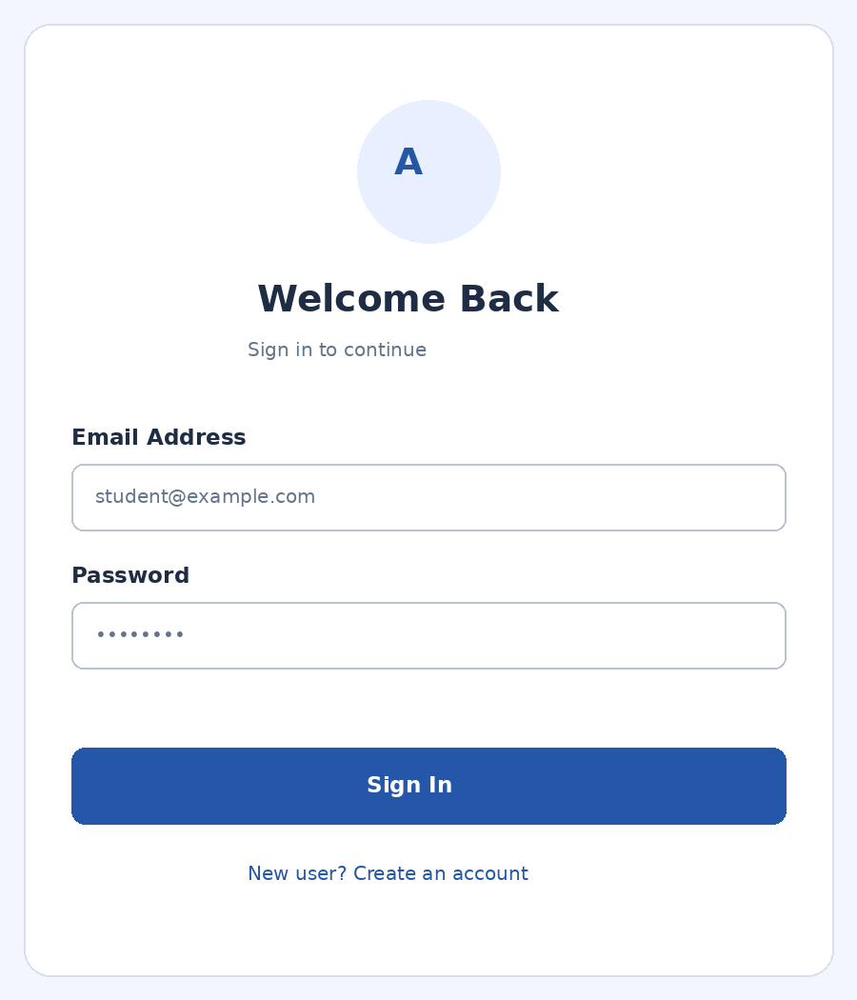

# Experiment 10 – User Authentication using Firestore

## Aim

To develop a Flutter application that provides secure user registration and login using email and password, with user profile information stored in Google Cloud Firestore.

## Description

This experiment implements a user authentication interface with registration, sign-in and sign-out features. Firebase Authentication securely creates user accounts and verifies email/password credentials. After registration, the user's email and account creation timestamp are stored in a Firestore users collection, using the Firebase Authentication UID as the document ID. The application listens to authStateChanges() to determine whether to display the login page or the home page. Input validation checks the email format and minimum password length, and authentication errors are shown to the user.

## Widgets and Concepts Used

- **firebase_core** – Initializes Firebase.
- **firebase_auth** – Registers users and authenticates sign-in requests.
- **cloud_firestore** – Stores user profile metadata in Firestore.
- **TextFormField** – Accepts email and password.
- **Form and GlobalKey** – Validate user input.
- **createUserWithEmailAndPassword()** – Creates a new account.
- **signInWithEmailAndPassword()** – Authenticates an existing user.
- **authStateChanges()** – Detects login/logout state changes.
- **signOut()** – Signs out the current user.

> Security note: Passwords must not be stored as plain text in Firestore. Firebase Authentication securely manages password credentials; Firestore stores only profile information such as email and account creation time. Enable Email/Password in Firebase Authentication, configure Firebase for Flutter, and add firebase_core, firebase_auth and cloud_firestore dependencies.

## Technologies Used

- Flutter
- Dart
- firebase_core
- firebase_auth
- cloud_firestore
- TextFormField
- Form and GlobalKey
- createUserWithEmailAndPassword()
- signInWithEmailAndPassword()
- authStateChanges()
- signOut()

## Setup

Create a Firebase project, enable the services used above, then run:

```bash
dart pub global activate flutterfire_cli
flutterfire configure
flutter pub get
flutter run
```

## Output Screenshots



## Result

Thus, a Flutter user authentication application was developed successfully. Users can register with email and password, sign in to an existing account, and sign out. Firebase Authentication manages credentials securely, while Firestore stores the user's profile information.
