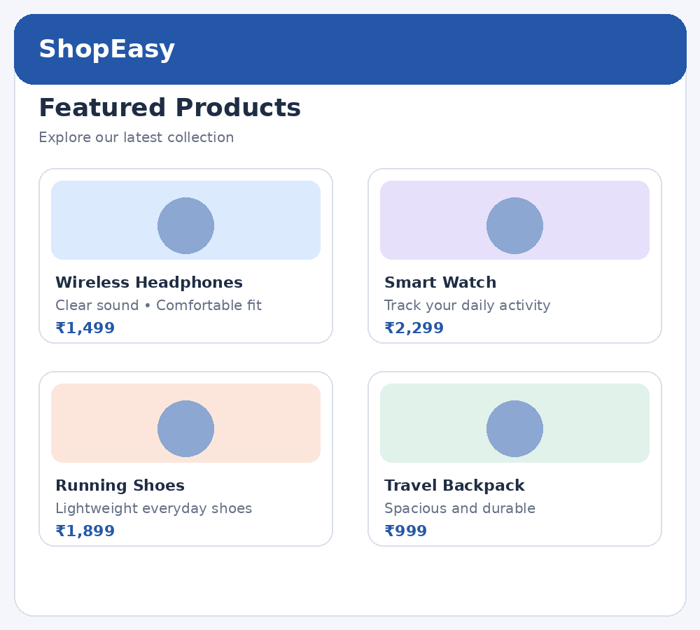

# Experiment 2 – Adaptive and Responsive UI Design

## Aim

To design and implement a responsive Flutter application for an E-Commerce Product Catalog by creating reusable custom product widgets. The application adapts to different screen sizes using responsive layout techniques.

## Description

Responsive UI design allows an application to adjust its layout according to the available screen width. Flutter provides LayoutBuilder and MediaQuery to obtain screen constraints and build layouts suitable for mobile phones, tablets and desktop screens. In this experiment, an e-commerce catalog named ShopEasy displays product details using reusable ProductCard widgets. LayoutBuilder checks the available width and selects one column for narrow screens, two columns for medium screens and three columns for wider screens. GridView.builder arranges the product cards in a grid and updates the layout according to the selected column count. Responsive Techniques and Widgets Used 1. LayoutBuilder: Reads the available layout constraints. 2. GridView.builder: Displays products in a scrollable grid. 3. SliverGridDelegateWithFixedCrossAxisCount: Controls the number of columns and spacing. 4. ProductCard: Reusable custom widget for each product. 5. Expanded: Uses the remaining available space. 6. Media adaptation: One column below 600 px, two columns from 600 px, and three columns from 900 px.

## Widgets Used


## Technologies Used

- Flutter
- Dart

## How to Run

```bash
flutter pub get
flutter run
```

## Output Screenshots



## Result

Thus, the responsive E-Commerce Product Catalog application was designed and implemented successfully using Flutter. Reusable ProductCard widgets and responsive grid layout techniques were used to adapt the product display to different screen sizes.
