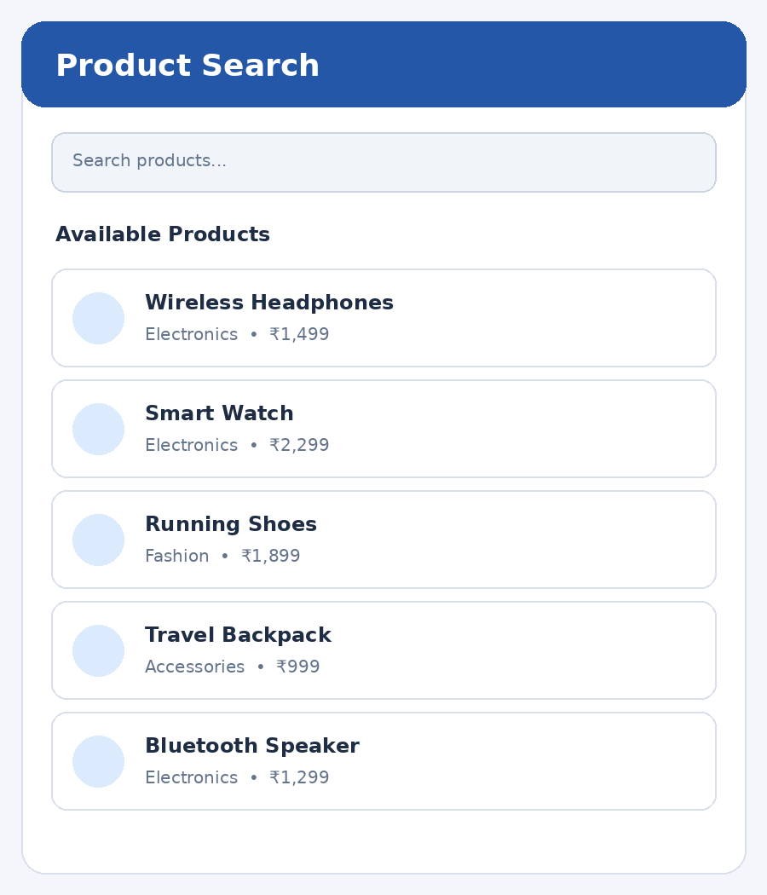

# Experiment 3 – Add Interactivity to App – Input and Forms

## Aim

To develop a Flutter application that displays a predefined list of products and allows users to search or filter the products using input widgets, providing an interactive user experience.

## Description

Input widgets allow users to enter information and interact with an application. In this experiment, a product search application is developed using TextField and DropdownButtonFormField. The TextField accepts a search keyword and filters product names as the user types. The dropdown allows the user to select a product category. A StatefulWidget is used to maintain the search text and selected category. The setState() method refreshes the interface whenever the input changes. ListView.builder displays the matching products, while a message is shown when no matching product is found.

## Widgets and Concepts Used

- **StatefulWidget** – Maintains changing search and filter values.
- **TextField** – Accepts the product search keyword.
- **TextEditingController** – Controls and clears the search input.
- **DropdownButtonFormField** – Filters products by category.
- **setState()** – Rebuilds the interface when input changes.
- **ListView.builder** – Displays the filtered product list.
- **dispose()** – Releases the text controller when the screen is removed.

## Technologies Used

- Flutter
- Dart
- StatefulWidget
- TextField
- TextEditingController
- DropdownButtonFormField
- setState()
- ListView.builder
- dispose()

## How to Run

```bash
flutter pub get
flutter run
```

## Output Screenshots



## Result

Thus, the Flutter product search application was developed successfully. Users can search products by entering keywords and filter the displayed products by category using input widgets. The interface updates dynamically based on the selected input.
