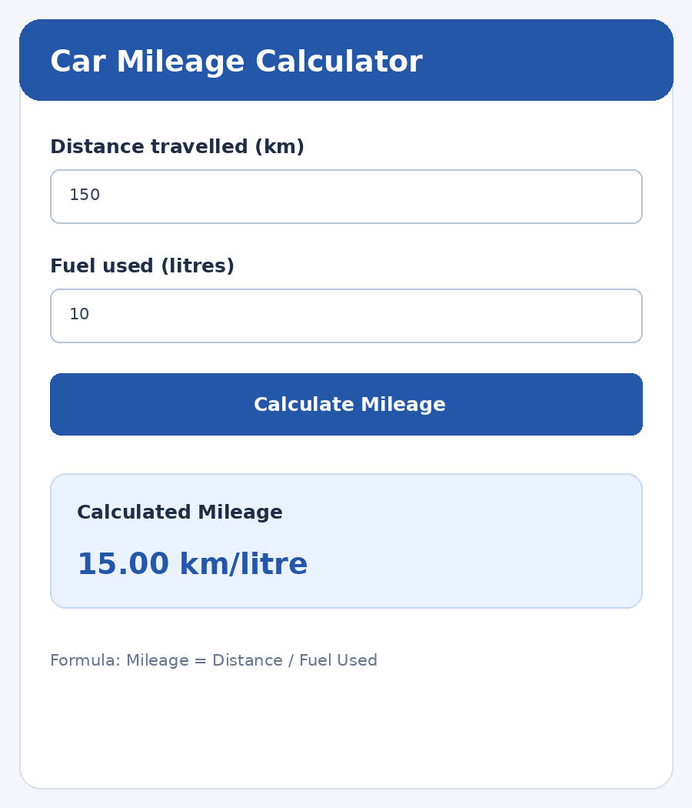

# Experiment 4 – Form Validation using Stateful Widgets

## Aim

To design and implement a Car Mileage Calculator using Flutter Forms, TextFormField, input widgets and Stateful Widgets. The application validates user inputs and displays the calculated mileage dynamically.

## Description

Form validation ensures that the user enters correct and meaningful values before a calculation is performed. In this experiment, a Car Mileage Calculator accepts the distance travelled in kilometres and the fuel consumed in litres. TextFormField widgets are used to collect the values, while a Form widget groups the input fields and validates them. A validator checks that each field is not empty and contains a valid positive number. When the form is valid, mileage is calculated by dividing distance by fuel consumed. StatefulWidget and setState() are used to update and display the result dynamically.

## Widgets and Concepts Used

- **StatefulWidget** – Maintains the calculated mileage state.
- **Form** – Groups input fields and performs validation.
- **TextFormField** – Accepts distance and fuel values.
- **TextEditingController** – Reads and clears user input.
- **GlobalKey** – Accesses the Form state for validation.
- **validator** – Checks empty, invalid and non-positive values.
- **setState()** – Refreshes the UI to show the calculated result.

> Formula: Mileage = Distance travelled (km) ÷ Fuel used (litres).

## Technologies Used

- Flutter
- Dart
- StatefulWidget
- Form
- TextFormField
- TextEditingController
- GlobalKey
- validator
- setState()

## How to Run

```bash
flutter pub get
flutter run
```

## Output Screenshots



## Result

Thus, the Car Mileage Calculator was developed successfully using Flutter Forms, TextFormField and StatefulWidget. Input validation was implemented, and the mileage was calculated and displayed dynamically for valid user inputs.
