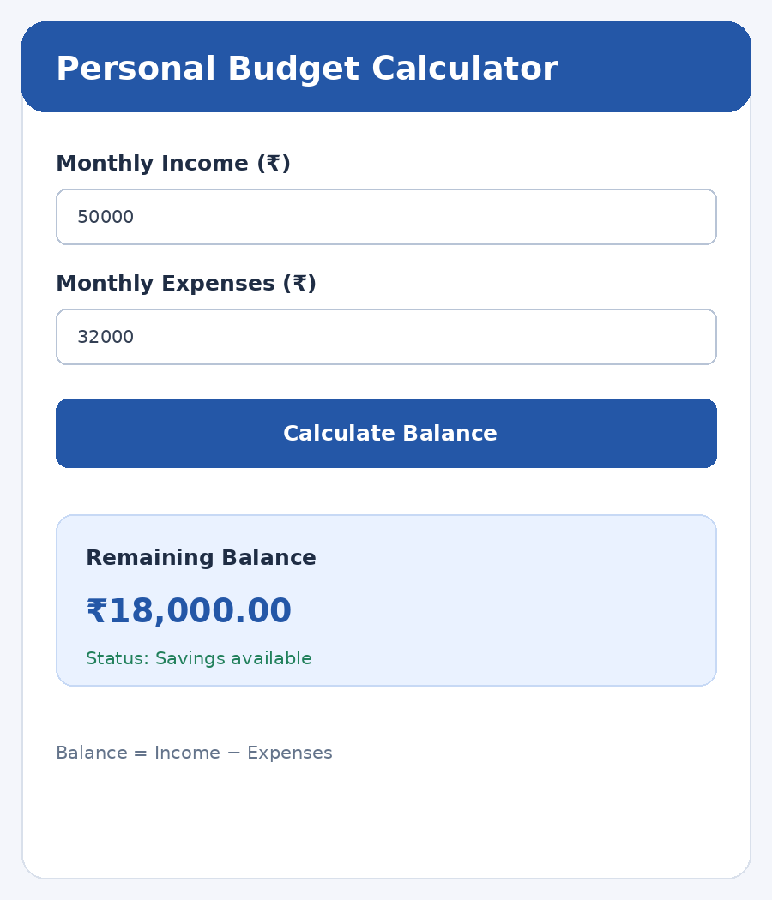

# Experiment 5 – Application State Management

## Aim

To develop a Personal Budget Calculator using Flutter state management techniques. The application accepts user income and expenses, calculates the remaining balance, and displays the user's financial status.

## Description

State management is used to store and update data that changes while an application is running. In this experiment, a Personal Budget Calculator accepts monthly income and monthly expenses through input fields. The application calculates the remaining balance by subtracting expenses from income. A StatefulWidget stores the calculated balance, and setState() updates the user interface whenever the calculation is performed or the fields are cleared. The application also displays a financial status indicating whether savings are available, expenses exceed income, or income and expenses are equal.

## Widgets and Concepts Used

- **StatefulWidget** – Maintains the changing budget data.
- **setState()** – Refreshes the UI when the balance changes.
- **TextFormField** – Accepts income and expense values.
- **TextEditingController** – Reads and clears the input values.
- **Form and GlobalKey** – Validate the entered amounts.
- **Card** – Displays the calculated financial summary.
- **dispose()** – Releases the text controllers.

> Formula: Remaining Balance = Monthly Income − Monthly Expenses.

## Technologies Used

- Flutter
- Dart
- StatefulWidget
- setState()
- TextFormField
- TextEditingController
- Form and GlobalKey
- Card
- dispose()

## How to Run

```bash
flutter pub get
flutter run
```

## Output Screenshots



## Result

Thus, the Personal Budget Calculator was developed successfully using Flutter state management. The application accepts income and expenses, calculates the remaining balance, and displays the financial status dynamically using StatefulWidget and setState().
