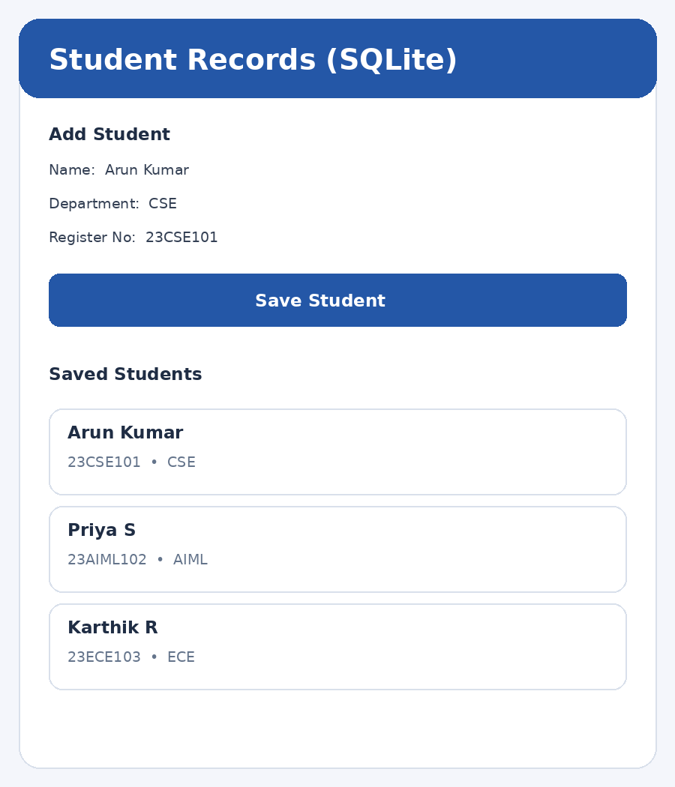

# Experiment 6 – Data Persistence using SQLite

## Aim

To design and develop a Flutter application that stores and retrieves student records using the SQLite database by implementing Create and Read operations.

## Description

SQLite is a lightweight relational database that stores data locally on a device. In this experiment, a Student Records application is developed to perform Create and Read operations. The user enters a student's name, register number and department through form fields. The sqflite package is used to create and access the SQLite database, while the path package helps construct the database file path. A students table is created when the database is first opened. The insertStudent() method saves a record, and getStudents() retrieves the stored records. The retrieved data is displayed in a ListView. Since the database is stored locally, records remain available after the application is closed and reopened. Packages and Concepts Used 1. sqflite: Provides SQLite database operations in Flutter. 2. path: Creates the database file path. 3. CREATE TABLE: Creates the students table. 4. INSERT: Saves a new student record (Create operation). 5. SELECT / query(): Retrieves saved student records (Read operation). 6. StatefulWidget: Updates the displayed list after inserting a record. 7. ListView.builder: Displays the retrieved student records. Dependency setup: Add sqflite and path to the project's dependencies in pubspec.yaml, then run flutter pub get.

## Widgets Used


## Technologies Used

- Flutter
- Dart

## How to Run

```bash
flutter pub get
flutter run
```

## Output Screenshots



## Result

Thus, the Flutter Student Records application was developed successfully using SQLite. The application creates a local database, inserts student details and retrieves the stored records for display, implementing the Create and Read operations.
