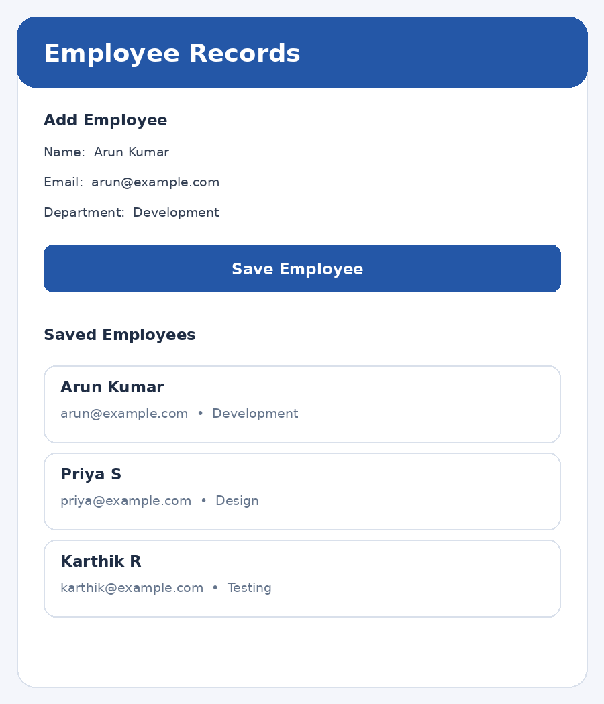

# Experiment 7 – Data Persistence using Google Cloud Firestore

## Aim

To develop a Flutter application that stores and retrieves employee or student information using Google Cloud Firestore, ensuring data persistence even after the application is closed and reopened.

## Description

Cloud Firestore is a NoSQL cloud database provided by Firebase. It stores application data as documents organized into collections and synchronizes data between the application and the cloud. In this experiment, an Employee Records application collects an employee's name, email address and department. The Cloud Firestore collection named 'employees' stores each employee as a document. The add() method inserts a new document, while snapshots() listens for changes and displays the retrieved documents in the application. Since the records are stored in the cloud, they remain available when the application is closed and reopened, provided the device has network access and the Firebase project is configured correctly. Packages and Concepts Used 1. firebase_core: Initializes Firebase in the Flutter application. 2. cloud_firestore: Connects the application to Cloud Firestore. 3. CollectionReference: Refers to the employees collection. 4. add(): Creates a new employee document. 5. snapshots(): Retrieves live updates from Firestore. 6. StreamBuilder: Displays records whenever Firestore data changes. 7. Document: Stores the fields for one employee. Setup requirement: Create a Firebase project, register the Flutter app, configure the platform files (or use FlutterFire CLI and its generated options), enable Cloud Firestore, and add firebase_core and cloud_firestore dependencies. This sample uses Firebase.initializeApp() and therefore requires the native Firebase configuration files to be in place.

## Widgets Used


## Technologies Used

- Flutter
- Dart

## Setup

Create a Firebase project, enable the services used above, then run:

```bash
dart pub global activate flutterfire_cli
flutterfire configure
flutter pub get
flutter run
```

## Output Screenshots



## Result

Thus, the Flutter Employee Records application was developed to store and retrieve employee information using Google Cloud Firestore. The application creates employee documents in the cloud and displays the records dynamically using StreamBuilder, enabling data persistence across application sessions.
