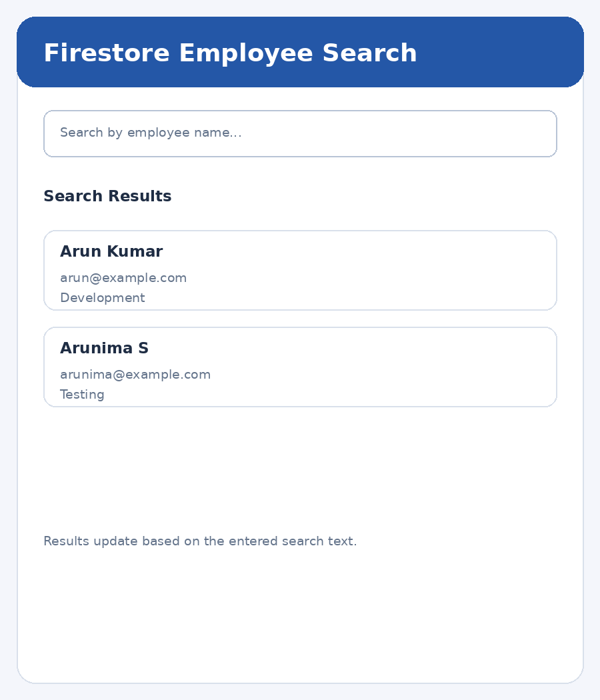

# Experiment 8 – Firestore Data Retrieval

## Aim

To design and implement a Flutter application that retrieves information from Google Cloud Firestore based on user search input and displays the corresponding records dynamically.

## Description

Cloud Firestore is a NoSQL cloud database that stores data as documents inside collections. In this experiment, an Employee Search application retrieves employee information from the 'employees' collection. A TextField accepts the employee name entered by the user. The application listens to Firestore data using snapshots() and displays the records with StreamBuilder. The entered search text is used to filter the retrieved employee names, and the matching records are displayed dynamically. If no record matches the search text, an appropriate message is shown.

## Widgets and Concepts Used

- **firebase_core** – Initializes Firebase.
- **cloud_firestore** – Connects to Cloud Firestore.
- **TextField** – Accepts the search input.
- **TextEditingController** – Controls and clears the search field.
- **snapshots()** – Listens for Firestore data updates.
- **StreamBuilder** – Builds the UI from the retrieved stream.
- **where()** – Filters records based on the entered employee name.
- **ListView.builder** – Displays the matching records.

> Setup requirement: Configure a Firebase project for the Flutter app, enable Cloud Firestore, and add firebase_core and cloud_firestore dependencies. The Firestore database must contain an employees collection with fields such as name, email and department.

## Technologies Used

- Flutter
- Dart
- firebase_core
- cloud_firestore
- TextField
- TextEditingController
- snapshots()
- StreamBuilder
- where()
- ListView.builder

## Setup

Create a Firebase project, enable the services used above, then run:

```bash
dart pub global activate flutterfire_cli
flutterfire configure
flutter pub get
flutter run
```

## Output Screenshots



## Result

Thus, the Flutter application was developed successfully to retrieve employee records from Google Cloud Firestore based on user search input. The matching records are displayed dynamically using TextField, StreamBuilder and ListView.builder.
