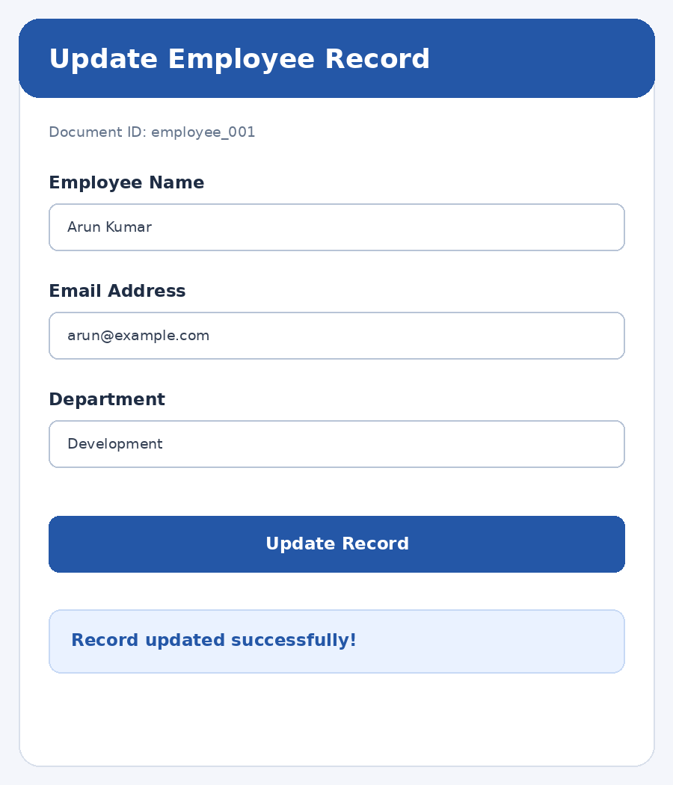

# Experiment 9 – Firestore Data Update

## Aim

To design and implement a Flutter application that allows users to update existing records stored in Google Cloud Firestore based on user input and displays the updated information.

## Description

Cloud Firestore stores application data as documents inside collections. In this experiment, an Employee Record Update application allows the user to select an existing employee document, retrieve its current details and modify the employee name, email address and department. A StreamBuilder displays the available employee records in a dropdown list. When a document is selected, its existing values are loaded into TextFormField widgets. The update() method writes the modified values to the selected Firestore document. A success or error message is displayed after the update operation.

## Widgets and Concepts Used

- **firebase_core** – Initializes Firebase.
- **cloud_firestore** – Connects the app to Firestore.
- **CollectionReference** – Refers to the employees collection.
- **DropdownButtonFormField** – Selects an existing employee record.
- **TextFormField** – Accepts updated employee details.
- **doc().get()** – Retrieves the selected document.
- **doc().update()** – Updates fields in the existing document.
- **StreamBuilder** – Displays the available employee records dynamically.

> Setup requirement: Configure Firebase for the Flutter app, enable Cloud Firestore, and add firebase_core and cloud_firestore dependencies. Create an employees collection containing employee documents with name, email and department fields.

## Technologies Used

- Flutter
- Dart
- firebase_core
- cloud_firestore
- CollectionReference
- DropdownButtonFormField
- TextFormField
- doc().get()
- doc().update()
- StreamBuilder

## Setup

Create a Firebase project, enable the services used above, then run:

```bash
dart pub global activate flutterfire_cli
flutterfire configure
flutter pub get
flutter run
```

## Output Screenshots



## Result

Thus, the Flutter application was developed successfully to update existing employee records stored in Google Cloud Firestore. The selected document is retrieved, its details are edited through input fields, and the changes are saved using the Firestore update() method.
